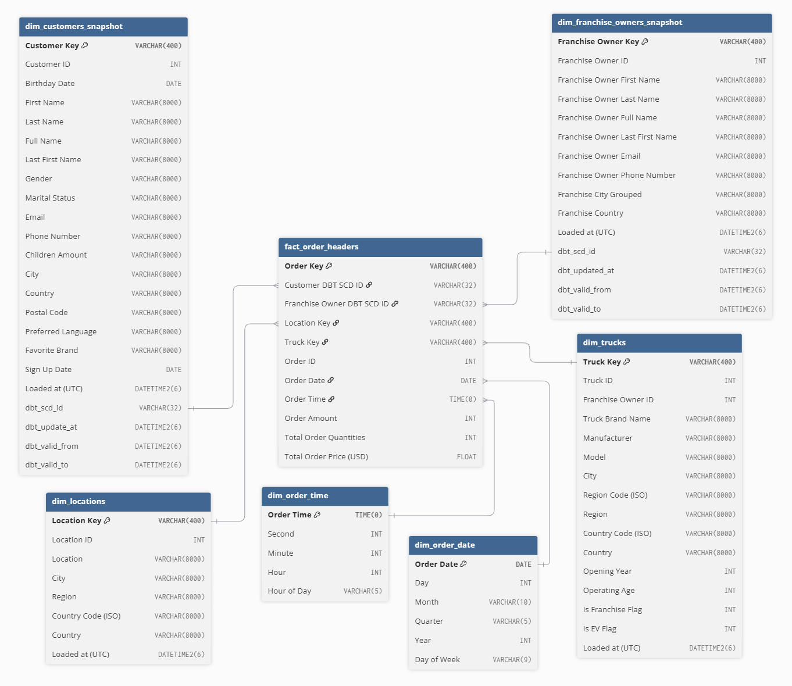
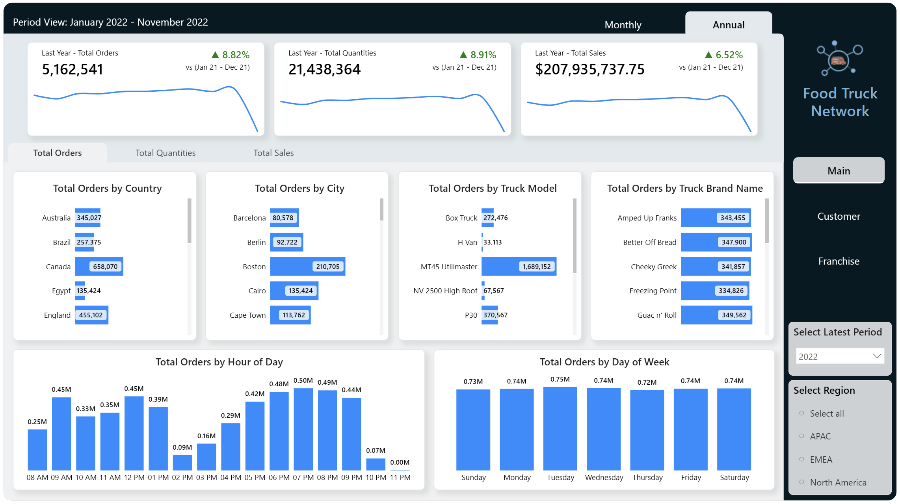
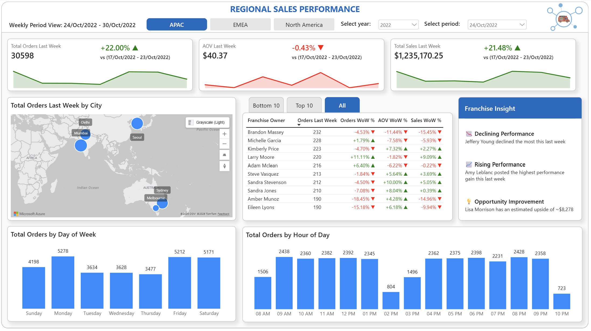
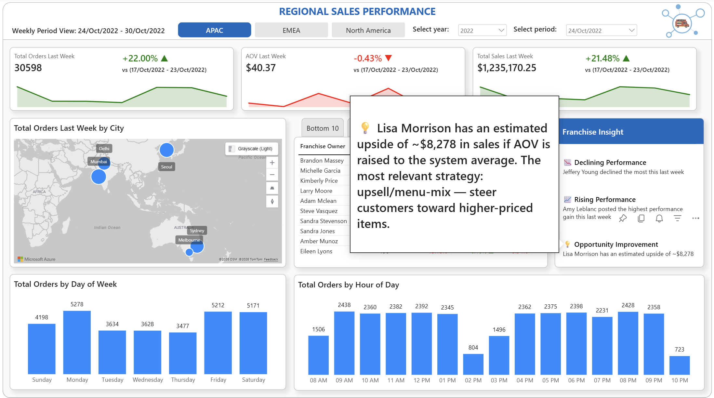

# End to End Analytics Case Study 

## 01 Company Overview
Sebuah perusahaan jaringan truk makanan menyediakan berbagai pilihan makanan yang unik dan berkualitas tinggi dengan cara yang praktis dan hemat biaya melalui pengantaran makanan yang mengutamakan penggunaan bahan-bahan segar dari supplier lokal. Saat ini, perusahaan ingin memodernisasi platform analitik perusahaan. Maka dari itu, perusahaan mulai merencanakan penggunaan Microsoft Fabric untuk menganalisis penjualannya.

## 02 Corporate Structure
Perusahaan memiliki beberapa tim di Departemen Sales yang tersebar di berbagai wilayah, serta tim yang terdiri dari data analisis dan data engineer yang mana tim ini akan menggunakan Microsoft Fabric dalam memproses data. Data engineer melakukan proses ekstraksi, transformasi, dan pemuatan data. Data engineer memilih bahasa pemrograman Python dan SQL dalam proses transformasinya. Sedangkan, data analisis melakukan kueri data dan membuat semantic model beserta laporan. Data analisis memiliki kemampuan untuk menulis kueri di T-SQL dan membuat laporan dengan Power BI. Tim di Departemen Sales akan menggunakan laporannya untuk menganalisis penjualan.

## 03 Microsoft Environment
Perusahaan memiliki workspace di Microsoft Fabric untuk melakukan analisis penjualan. Perusahaan memiliki langganan Microsoft Azure dan membuat security group di Microsoft Entra ID untuk tim di Departemen Sales yang terbagi berdasarkan wilayah, yaitu:
- APAC → berisi tim di Departemen Sales wilayah APAC.
- EMEA → berisi tim di Departemen Sales wilayah EMEA.
- North America → berisi tim di Departemen Sales wilayah North America.

Selain Microsoft Entra ID, perusahaan telah memiliki organisasi Azure DevOps. Dalam organisasi Azure DevOps, perusahaan membuat proyek baru untuk repositories berkaitan dengan Microsoft Fabric. Perusahaan merencanakan penggunaan repositories di Azure DevOps sebagai source control untuk Fabric Workspace.

## 04 User Problem
Tim di Departemen Sales yang tersebar di berbagai wilayah membutuhkan pemantauan performa penjualan pemilik franchise yang efektif dibandingkan dengan pembuatan laporan penjualan secara manual. Tim merasa pembuatan laporan penjualan setiap minggunya membutuhkan waktu lebih lama pada saat pengumpulan data dibandingkan waktu menganalisisnya, sehingga proses identifikasi performa pemilik franchise terlewatkan. Maka dari itu, perusahaan ingin mengubah pembuatan laporan menjadi dashboard dan mengurangi waktu pengumpulan data dengan bantuan Microsoft Fabric, agar tim di Departemen Sales lebih mengutamakan alokasi waktunya untuk menganalisis dan merespon performa penjualan pemilik franchise di wilayah masing-masing.

## 05 Source System
Perusahaan memiliki data penjualan semua wilayah yang tersimpan di S3 bucket dan dapat diakses secara publik melalui requests ke S3 bucket. Perusahaan berencana menyimpan data tersebut di Fabric Lakehouse untuk memudahkan dalam memproses data di lingkungan Microsoft. Data penjualan terdiri dari beberapa dataset, yaitu:
- Dataset pertama:
    - Nama → raw_customer
    - Deskripsi data → Data perusahaan yang mencatat informasi pelanggan.
    - Bentuk data → Data terstruktur yang tersimpan dalam sebuah folder bernama raw_customer yang terdiri dari file berekstensi .csv terkompresi.
    - Ukuran data → ± 7 MB
    - Pengelompokkan tipe data → Dataset dikelompokkan dalam dua tipe data, yaitu categorical data dan date and time data untuk konteks dalam analisis.

- Dataset kedua:
    - Nama → franchise
    - Deskripsi data → Data perusahaan yang mencatat informasi pemilik franchise.
    - Bentuk data → Data terstruktur yang tersimpan dalam sebuah folder bernama franchise yang terdiri dari file berekstensi .csv terkompresi.
    - Ukuran data → ± 8 KB
    - Pengelompokkan tipe data → Dataset dikelompokkan dalam categorical data untuk konteks dalam analisis.

- Dataset ketiga:
    - Nama → location
    - Deskripsi data → Data perusahaan yang mencatat informasi lokasi jangkauan perusahaan.
    - Bentuk data → Data terstruktur yang tersimpan dalam sebuah folder bernama location yang terdiri dari file berekstensi .csv terkompresi.
    - Ukuran data → ± 233 KB
    - Pengelompokkan tipe data → Dataset dikelompokkan dalam categorical data untuk konteks dalam analisis.

- Dataset keempat:
    - Nama → menu
    - Deskripsi data → Data perusahaan yang mencatat informasi menu per item.
    - Bentuk data → Data terstruktur yang tersimpan dalam sebuah folder bernama menu yang terdiri dari file berekstensi .csv terkompresi.
    - Ukuran data → ± 3 KB
    - Pengelompokkan tipe data → Dataset dikelompokkan dalam dua tipe data, yaitu categorical data dan continuous data untuk konteks maupun pengukuran metrik yang akan digunakan dalam analisis.

- Dataset kelima:
    - Nama → order_detail
    - Deskripsi data → Data perusahaan yang mencatat informasi pesanan per item.
    - Bentuk data → Data terstruktur yang tersimpan dalam sebuah folder bernama order_detail yang terdiri dari file berekstensi .csv terkompresi.
    - Ukuran data → ± 3,8 GB
    - Pengelompokkan tipe data → Dataset dikelompokkan dalam continuous data untuk pengukuran metrik yang akan digunakan dalam analisis.

- Dataset keenam:
    - Nama → order_header
    - Deskripsi data → Data perusahaan yang mencatat informasi per pesanan.
    - Bentuk data → Data terstruktur yang tersimpan dalam sebuah folder bernama order_header yang terdiri dari file berekstensi .csv terkompresi.
    - Ukuran data → ± 2,6 GB
    - Pengelompokkan tipe data → Dataset dikelompokkan dalam categorical data untuk konteks dalam analisis.

- Dataset ketujuh:
    - Nama → truck
    - Deskripsi data → Data perusahaan yang mencatat informasi truk.
    - Bentuk data → Data terstruktur yang tersimpan dalam sebuah folder bernama truck yang terdiri dari file berekstensi .csv terkompresi.
    - Ukuran data → ± 5 KB
    - Pengelompokkan tipe data → Dataset dikelompokkan dalam dua tipe data, yaitu categorical data dan continuous data untuk konteks dalam analisis.

## 06 Data Pipeline
Pemrosesan data dari sumber harus mengikuti medallion architecture yang menggunakan tiga lapisan berikut: bronze, silver, dan gold. Terdapat pembersihan dan pengayaan data dalam lapisan silver, termasuk deduplikasi, penanganan nilai kosong, dan standarisasi struktur tabel, seperti nama kolom dan tipe datanya. Dalam lapisan gold, data ditransformasikan dengan menggunakan star schema untuk menyesuaikan kebutuhan analisis penjualan.

Setiap lapisan dalam mentransformasikan datanya harus berhasil sebelum berlanjut ke lapisan berikutnya. Maka dari itu, diperlukan pembuatan alur data dengan menggunakan Fabric Pipeline untuk mengikuti medallion architecture dan memenuhi kebutuhan analisis penjualan. Pembuatan alur data dilakukan di PL_FoodTruckNetwork pipeline.

Penyimpanan data hasil transformasi setiap lapisan dibuat dengan menggunakan Fabric Lakehouse dan Fabric Warehouse sebagai berikut:
- LH_FoodTruckNetwork → Sebuah Fabric Lakehouse yang digunakan untuk menyimpan data hasil transformasi lapisan bronze (ekstrasi data dari sumber) dan menyimpan data hasil transformasi lapisan silver.
- WH_FoodTruckNetwork → Sebuah Fabric Warehouse yang digunakan untuk menyimpan data hasil transformasi lapisan gold.

## 07 Data Security
Keamanan data di Microsoft Fabric harus memenuhi persyaratan berikut:
- Data engineer harus memiliki akses Read dan Write pada semua penyimpanan data di Fabric Lakehouse maupun Fabric Warehouse. Data engineer dalam membuat dan menghapus items di Fabric Workspace. Data engineer harus dapat melakukan commit perubahan pada source control di Azure DevOps melalui Git Integration di Fabric Workspace. 
- Data analisis harus hanya memiliki akses Read pada penyimpanan data hasil transformasi lapisan gold di Fabric Warehouse. Data analisis harus tidak memiliki akses Read pada penyimpanan data hasil transformasi bronze maupun silver di Fabric Lakehouse. Data analisis diperbolehkan Build semantic model di Fabric Semantic Model dan Create laporan di Fabric Report.  
- Tim masing-masing wilayah di Departemen Sales hanya memiliki akses Read pada penyimpanan data hasil transformasi lapisan gold di Fabric Warehouse dan hanya bisa mengkueri tabel-tabel yang digunakan di Fabric Semantic Model dan Fabric Report. Tim ini hanya bisa melihat laporan di wilayah masing-masing, tidak diperbolehkan untuk melihat laporan di wilayah lainnya, dan tidak diperbolehkan melihat secara utuh informasi pribadi pelanggan, yaitu nama, email, nomor telepon, dan tanggal lahir.

## 08 Semantic model
Pemodelan data hasil transformasi lapisan gold dilakukan di Fabric Semantic Model dengan cara menyambungkan relasi tabel fakta dan tabel dimensi agar membentuk star schema. Pembuatan semantic model ini dilakukan di SM_FoodTruckNetwork semantic model. Beberapa tabel hasil transformasi lapisan gold yang digunakan untuk tabel dimensi dan tabel fakta adalah sebagai berikut:

- Tabel fact_order_headers
    - Granularitas → Setiap baris data pada tabel fact_order_headers mewakili satu pesanan yang dilakukan oleh pelanggan tertentu pada pemiliki franchise tertentu dengan tanggal dan waktu tertentu di lokasi tertentu melalui pengiriman dengan truk tertentu.
    - Pertanyaan masalah bisnis yang bisa dianalisis (HOW) → Berapa total pesanan pada waktu tertentu?
    - Jawaban yang dapat disajikan → 1) Total pesanan; 2) Total penjualan.
    - Kolom dan tipe data

        | Nama kolom                    | Tipe data     | Pengelompokkan tipe data  |
        |-------------------------------|---------------|---------------------------|
        | Order Key                     | VARCHAR(400)  | Surrogate key             |
        | Customer DBT SCD ID           | VARCHAR(32)   | Foreign key               |
        | Franchise Owner DBT SCD ID    | VARCHAR(32)   | Foreign key               |
        | Location Key                  | VARCHAR(400)  | Foreign key               |
        | Truck Key                     | VARCHAR(400)  | Foreign key               |
        | Order ID                      | INT           | Degenerate dimension      |
        | Order Date                    | DATE          | Foreign key               |
        | Order Time                    | TIME(0)       | Foreign key               |
        | Order Amount                  | INT           | Continuous data/Measure   |
        | Total Order Quantities        | INT           | Continuous data/Measure   |
        | Total Order Price (USD)       | FLOAT         | Continuous data/Measure   |

    - Kolom referensi

        | Nama kolom referensi          | Tujuan kolom  | Tujuan tabel                  |
        |-------------------------------|---------------|-------------------------------|
        | Customer DBT SCD ID           | dbt_scd_id    | dim_customers_snapshot        |
        | Franchise Owner DBT SCD ID    | dbt_scd_id    | dim_franchise_owners_snapshot |
        | Location Key                  | Location Key  | dim_locations                 |
        | Truck Key                     | Truck Key     | dim_trucks                    |
        | Order Date                    | Order Date    | dim_order_date                |
        | Order Time                    | Order Time    | dim_order_time                |

- Tabel dim_customers_snapshot
    - Pertanyaan masalah bisnis yang bisa dianalisis (WHO) → Siapa nama pelanggan yang telah melakukan pesanan pada tanggal dan waktu tertentu?
    - Jawaban yang dapat disajikan → 1) Nama lengkap pelanggan; 2) Kota tempat pelanggan tinggal; 3) Tanggal mendaftar menjadi pelanggan.
    - Kolom dan tipe data

        | Nama kolom                    | Tipe data     | Pengelompokkan tipe data                  |
        |-------------------------------|---------------|-------------------------------------------|
        | Customer Key                  | VARCHAR(400)  | Surrogate key                             |
        | Customer ID                   | INT           | Natural key                               |
        | Birthday Date                 | DATE          | Date and time data/Dimension attribute    |
        | First Name                    | VARCHAR(8000) | Categorical data/Dimension attribute      |
        | Last Name                     | VARCHAR(8000) | Categorical data/Dimension attribute      |
        | Full Name                     | VARCHAR(8000) | Categorical data/Dimension attribute      |
        | Last First Name               | VARCHAR(8000) | Categorical data/Dimension attribute      |
        | Gender                        | VARCHAR(8000) | Categorical data/Dimension attribute      |
        | Marital Status                | VARCHAR(8000) | Categorical data/Dimension attribute      |
        | Email                         | VARCHAR(8000) | Categorical data/Dimension attribute      |
        | Phone Number                  | VARCHAR(8000) | Categorical data/Dimension attribute      |
        | Children Amount               | VARCHAR(8000) | Categorical data/Dimension attribute      |
        | City                          | VARCHAR(8000) | Categorical data/Dimension attribute      |
        | Country                       | VARCHAR(8000) | Categorical data/Dimension attribute      |
        | Postal Code                   | VARCHAR(8000) | Categorical data/Dimension attribute      |
        | Preferred Language            | VARCHAR(8000) | Categorical data/Dimension attribute      |
        | Favorite Brand                | VARCHAR(8000) | Categorical data/Dimension attribute      |
        | Sign Up Date                  | DATE          | Date and time data/Dimension attribute    |
        | Loaded at (UTC)               | DATETIME2(6)  | Date and time data                        |
        | dbt_scd_id                    | VARCHAR(32)   | Surrogate key                             |
        | dbt_update_at                 | DATETIME2(6)  | Date and time data                        |
        | dbt_valid_from                | DATETIME2(6)  | Date and time data                        |
        | dbt_valid_to                  | DATETIME2(6)  | Date and time data                        |

- Tabel dim_franchise_owners_snapshot
    - Pertanyaan masalah bisnis yang bisa dianalisis (WHO) → Siapa nama pemilik franchise yang telah menerima pesanan pada tanggal dan waktu tertentu?
    - Jawaban yang dapat disajikan → 1) Nama lengkap pemilik franchise; 2) Negara tempat franchise berada.
    - Kolom dan tipe data
    
        | Nama kolom                        | Tipe data     | Pengelompokkan tipe data              |
        |-----------------------------------|---------------|---------------------------------------|
        | Franchise Owner Key               | VARCHAR(400)  | Surrogate key                         |
	    | Franchise Owner ID                | INT           | Natural key                           |
	    | Franchise Owner First Name        | VARCHAR(8000) | Categorical data/Dimension attribute  |
	    | Franchise Owner Last Name         | VARCHAR(8000) | Categorical data/Dimension attribute  |
	    | Franchise Owner Full Name         | VARCHAR(8000) | Categorical data/Dimension attribute  |
	    | Franchise Owner Last First Name   | VARCHAR(8000) | Categorical data/Dimension attribute  |
	    | Franchise Owner Email             | VARCHAR(8000) | Categorical data/Dimension attribute  |
	    | Franchise Owner Phone Number      | VARCHAR(8000) | Categorical data/Dimension attribute  |
	    | Franchise City Grouped            | VARCHAR(8000) | Categorical data/Dimension attribute  |
	    | Franchise Country                 | VARCHAR(8000) | Categorical data/Dimension attribute  |
	    | Loaded at (UTC)                   | DATETIME2(6)  | Date and time data                    |
	    | dbt_scd_id                        | VARCHAR(32)   | Surrogate key                         |
	    | dbt_updated_at                    | DATETIME2(6)  | Date and time data                    |
	    | dbt_valid_from                    | DATETIME2(6)  | Date and time data                    |
	    | dbt_valid_to                      | DATETIME2(6)  | Date and time data                    |

- Tabel dim_locations
    - Pertanyaan masalah bisnis yang bisa dianalisis (WHERE) → Dimana wilayah dengan jumlah pesanan paling banyak?
    - Jawaban yang dapat disajikan → 1) Kota tempat pesanan dilakukan; 2) Wilayah; 3) Negara.
    - Kolom dan tipe data

        | Nama kolom            | Tipe data     | Pengelompokkan tipe data              |
        |-----------------------|---------------|---------------------------------------|
        | Location Key          | VARCHAR(400)  | Surrogate key                         |
	    | Location ID           | INT           | Natural key                           |
	    | Location              | VARCHAR(8000) | Categorical data/Dimension attribute  |
	    | City                  | VARCHAR(8000) | Categorical data/Dimension attribute  |
	    | Region                | VARCHAR(8000) | Categorical data/Dimension attribute  |
	    | Country Code (ISO)    | VARCHAR(8000) | Categorical data/Dimension attribute  |
	    | Country               | VARCHAR(8000) | Categorical data/Dimension attribute  |
	    | Loaded at (UTC)       | DATETIME2(6)  | Date and time data                    |

- Tabel dim_order_date
    - Pertanyaan masalah bisnis yang bisa dianalisis (WHAT) → Apa nama hari dalam seminggu yang jumlah pesanan paling banyak dibandingkan hari lainnya?
    - Jawaban yang dapat disajikan → 1) Tahun; 2) Kuartal; 3) Nama bulan; 4) Tanggal; 5) Nama hari dalam seminggu.
    - Konteks hierarki → 1) Tahun; 2) Kuartal; 3) Nama bulan; 4) Tanggal.
    - Kolom dan tipe data

        | Nama kolom    | Tipe data     | Pengelompokkan tipe data              |
        |---------------|---------------|---------------------------------------|
        | Order Date    | DATE          | Primary key                           |
	    | Day           | INT           | Continuous data/Dimension attribute   |
	    | Month         | VARCHAR(10)   | Categorical data/Dimension attribute  |
	    | Quarter       | VARCHAR(5)    | Categorical data/Dimension attribute  |
	    | Year          | INT           | Continuous data/Dimension attribute   |
	    | Day of Week   | VARCHAR(9)    | Categorical data/Dimension attribute  |

- Tabel dim_order_time
    - Pertanyaan masalah bisnis yang bisa dianalisis (HOW) → Waktu berapa yang jumlah pesanan paling banyak dibandingkan waktu lainnya?
    - Jawaban yang dapat disajikan → 1) Jam; 2) Menit; 3) Detik; 4) Waktu dalam sehari.
    - Konteks hierarki → 1) Jam; 2) Menit; 3) Detik.
    - Kolom dan tipe data

        | Nama kolom    | Tipe data     | Pengelompokkan tipe data              |
        |---------------|---------------|---------------------------------------|
        | Order Time    | TIME(0)       | Primary key                           |
	    | Second        | INT           | Continuous data/Dimension attribute   |
	    | Minute        | INT           | Continuous data/Dimension attribute   |
	    | Hour          | INT           | Continuous data/Dimension attribute   |
	    | Hour of Day   | VARCHAR(5)    | Categorical data/Dimension attribute  |

- Tabel dim_trucks
    - Pertanyaan masalah bisnis yang bisa dianalisis (WHAT) → Apa nama merk truk yang digunakan untuk pengiriman sebuah pesanan?
    - Jawaban yang dapat disajikan → 1) Nama merk truk; 2) Nama manufaktur; 3) Kota tempat truck berada.
    - Kolom dan tipe data

        | Nama kolom            | Tipe data     | Pengelompokkan tipe data              |
        |-----------------------|---------------|---------------------------------------|
        | Truck Key             | VARCHAR(400)  | Surrogate key                         |
	    | Truck ID              | INT           | Natural key                           |
	    | Franchise Owner ID    | INT           | Natural key                           |
	    | Truck Brand Name      | VARCHAR(8000) | Categorical data/Dimension attribute  |
	    | Manufacturer          | VARCHAR(8000) | Categorical data/Dimension attribute  | 
	    | Model                 | VARCHAR(8000) | Categorical data/Dimension attribute  | 
	    | City                  | VARCHAR(8000) | Categorical data/Dimension attribute  | 
	    | Region Code (ISO)     | VARCHAR(8000) | Categorical data/Dimension attribute  | 
	    | Region                | VARCHAR(8000) | Categorical data/Dimension attribute  | 
	    | Country Code (ISO)    | VARCHAR(8000) | Categorical data/Dimension attribute  | 
	    | Country               | VARCHAR(8000) | Categorical data/Dimension attribute  | 
	    | Opening Year          | INT           | Continuous data/Dimension attribute   |
	    | Operating Age         | INT           | Continuous data/Dimension attribute   | 
	    | Is Franchise Flag     | INT           | Continuous data/Dimension attribute   | 
	    | Is EV Flag            | INT           | Continuous data/Dimension attribute   | 
	    | Loaded at (UTC)       | DATETIME2(6)  | Date and time data                    |

## 09 Visualizing Data
Visualisasi data menggunakan semantic model di Fabric Report. Visualisasi data ini merupakan proses pembuatan dashboard yang mana dilakukan di WeeklyDashboard_FoodTruckNetwork. Berikut halaman yang ditampilkan pada dashboard tersebut, yaitu:

### 09-1 Halaman - Main 
Berikut tampilan dashboard halaman main dalam seminggu sepanjang periode 24 Oktober 2022 - 30 Oktober 2022 untuk tim di Departemen Sales semua wilayah.

Berikut tampilan laporan halaman main dalam seminggu sepanjang periode 24 Oktober 2022 - 30 Oktober 2022 untuk tim di Departemen Sales wilayah APAC. 

Berikut tampilan salah satu tooltip (opportunity improvement) periode 24 Oktober 2022 - 30 Oktober 2022 untuk tim di Departemen Sales wilayah APAC.

Bagian halaman ini menampilkan ringkasan performa penjualan di wilayah dan bulan tertentu dan perbandingannya setiap pemilik franchise. Beberapa bentuk visualisasi yang ditampilkan pada bagian halaman ini, yaitu sebagai berikut:
- Input Button:
- Select region → Filter wilayah. Tim masing-masing wilayah di Departemen Sales hanya ditampilkan pilihan untuk data wilayah tim tersebut.

- Slicer:
    - Select year → Filter tahun. Pengguna bisa mempersempit pilihan periode seminggu dengan memilih tahun tertentu atau sepanjang tahun.
    - Select period → Filter periode seminggu. Pengguna bisa memantau performa seminggu yang terakhir diperbarui maupun performa minggu-minggu sebelumnya.

- Cards:
    - Total Orders Last Week → Jumlah pesanan di wilayah dan minggu tertentu. Terdapat persentase perubahan jumlah pesanan terhadap minggu sebelumnya dan trend jumlah pesanan sepanjang minggu tertentu.
    - AOV Last Week → Rata-rata nilai pesanan dalam satuan USD di wilayah dan minggu tertentu. Terdapat persentase perubahan rata-rata nilai pesanan terhadap minggu sebelumnya dan trend rata-rata nilai pesanan yang telah dipesan sepanjang minggu tertentu.
    - Total Sales Last Week → Total penjualan dalam satuan USD di wilayah dan minggu tertentu. Terdapat persentase perubahan total penjualan terhadap minggu sebelumnya dan trend total penjualan sepanjang minggu tertentu.
    - Franchise Insight:
        - Declining Performance → Pemilik franchise yang paling mengalami penurunan performa di wilayah dan minggu tertentu. Terdapat tooltip yang menjelaskan penyebab penurunan performa (cross-selling/upselling).
        - Rising Performance → Pemilik franchise yang paling mengalami kenaikan performa di wilayah dan minggu tertentu. Terdapat tooltip yang menjelaskan penyebab kenaikan performa (cross-selling/upselling).
        - Opportunity Improvement → Pemilik franchise yang paling memiliki kesempatan peningkatan performa di wilayah dan minggu tertentu. Terdapat tooltip yang memberikan strategi yang paling sesuai (cross-selling/upselling).

- Azure Maps:
    - Total Orders Last Week by Country → Jumlah pesanan berdasarkan negara di wilayah dan minggu tertentu.

- Tables, dengan kolom Orders Last Week (jumlah pesanan), Orders WoW % (persentase perubahan jumlah pesanan), AOV WoW % (persentase perubahan rata-rata nilai pesanan), Sales WoW % (persentase perubahan penjualan):
    - Bottom 10 → 10 pemilik franchise dengan jumlah pesanan terendah di wilayah dan minggu tertentu.
    - Top 10 → 10 pemilik franchise dengan jumlah pesanan tertinggi di wilayah dan minggu tertentu.
    - All → Semua pemilik franchise yang diurutkan mulai dari jumlah pesanan tertinggi hingga terendah di wilayah dan minggu tertentu.

- Charts:
    - Total Orders by Day of Week → Jumlah pesanan berdasarkan hari dalam seminggu di wilayah dan minggu tertentu.
    - Total Orders by Hour of Day → Jumlah pesanan berdasarkan waktu dalam sehari di wilayah dan minggu tertentu.

