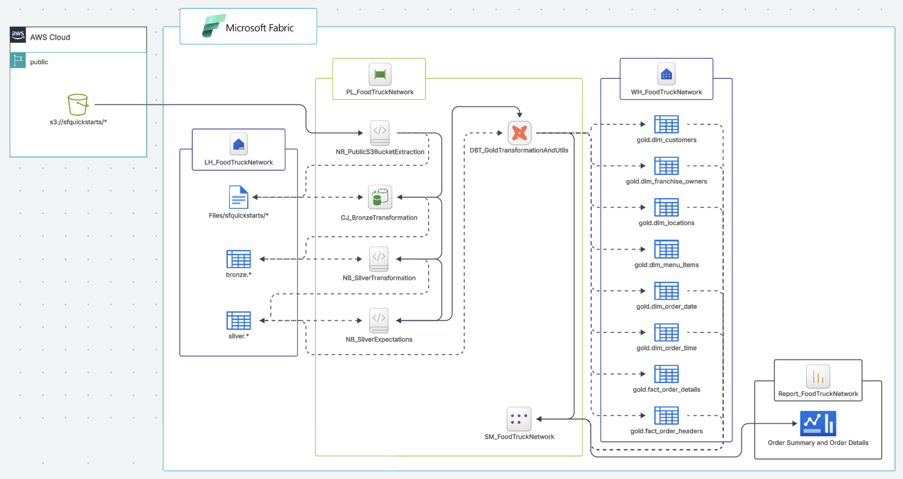

# End to End Analytics Case Study 

## 01 Company Overview
Sebuah perusahaan jaringan truk makanan menyediakan berbagai pilihan makanan yang unik dan berkualitas tinggi dengan cara yang praktis dan hemat biaya melalui pengantaran makanan yang mengutamakan penggunaan bahan-bahan segar dari supplier lokal. Saat ini, perusahaan ingin memodernisasi platform analitik perusahaan. Maka dari itu, perusahaan mulai merencanakan penggunaan Microsoft Fabric untuk menganalisis penjualannya.

## 02 Corporate Structure
Perusahaan memiliki beberapa tim di Departemen Sales yang tersebar di berbagai wilayah, serta tim yang terdiri dari data analisis dan data engineer yang mana tim ini akan menggunakan Microsoft Fabric dalam memproses data. Data engineer melakukan proses ekstraksi, transformasi, dan pemuatan data. Data engineer memilih bahasa pemrograman Python dan SQL dalam proses transformasinya. Sedangkan, data analisis melakukan kueri data dan membuat semantic model beserta laporan. Data analisis memiliki kemampuan untuk menulis kueri di T-SQL dan membuat laporan dengan Power BI. Tim di Departemen Sales akan menggunakan laporannya untuk menganalisis penjualan.

## 03 Microsoft Environment
Perusahaan memiliki workspace di Microsoft Fabric untuk melakukan analisis penjualan. Perusahaan memiliki langganan Microsoft Azure dan membuat security group di Microsoft Entra ID untuk tim di Departemen Sales yang terbagi berdasarkan wilayah, yaitu:
- APAC → berisi tim data analisis di wilayah APAC.
- EMEA → berisi tim data analisis di wilayah EMEA.
- North America → berisi tim data analisis di wilayah North America.

Selain Microsoft Entra ID, perusahaan telah memiliki organisasi Azure DevOps. Dalam organisasi Azure DevOps, perusahaan membuat proyek baru untuk repositories berkaitan dengan Microsoft Fabric. Perusahaan merencanakan penggunaan repositories di Azure DevOps sebagai source control untuk Fabric Workspace.

## 04 User Problem
Tim di Departemen Sales yang tersebar di berbagai wilayah membutuhkan laporan penjualan yang efektif dibandingkan dengan pembuatan laporan penjualan secara manual. Tim biasanya membutuhkan satu minggu untuk membuat dan menganalisis laporan penjualannya. Maka dari itu, perusahaan ingin mengurangi waktu pembuatan laporan menjadi satu hari dengan menggunakan Microsoft Fabric, agar tim di Departemen Sales lebih mengutamakan alokasi waktunya untuk menganalisis dan merespon tren penjualan di wilayah masing-masing.

## 05 Source System
Perusahaan memiliki data penjualan semua wilayah yang tersimpan di S3 bucket dan dapat diakses secara publik melalui requests ke S3 bucket. Perusahaan berencana menyimpan data tersebut di Fabric Lakehouse untuk memudahkan dalam memproses data di lingkungan Microsoft. Data penjualan terdiri dari beberapa dataset, yaitu:
- Dataset pertama:
    - Nama → raw_customer
    - Deskripsi data → Data perusahaan yang mencatat informasi pelanggan.
    - Bentuk data → Data terstruktur yang tersimpan dalam sebuah folder bernama raw_customer yang terdiri dari file berekstensi .csv terkompresi.
    - Ukuran data → ± 7 MB
    - Pengelompokkan tipe data → Dataset dikelompokkan dalam dua tipe data, yaitu categorical data dan date and time data untuk konteks dalam analisis.

- Dataset kedua:
    - Nama → franchise
    - Deskripsi data → Data perusahaan yang mencatat informasi pemilik franchise.
    - Bentuk data → Data terstruktur yang tersimpan dalam sebuah folder bernama franchise yang terdiri dari file berekstensi .csv terkompresi.
    - Ukuran data → ± 8 KB
    - Pengelompokkan tipe data → Dataset dikelompokkan dalam categorical data untuk konteks dalam analisis.

- Dataset ketiga:
    - Nama → location
    - Deskripsi data → Data perusahaan yang mencatat informasi lokasi jangkauan perusahaan.
    - Bentuk data → Data terstruktur yang tersimpan dalam sebuah folder bernama location yang terdiri dari file berekstensi .csv terkompresi.
    - Ukuran data → ± 233 KB
    - Pengelompokkan tipe data → Dataset dikelompokkan dalam categorical data untuk konteks dalam analisis.

- Dataset keempat:
    - Nama → menu
    - Deskripsi data → Data perusahaan yang mencatat informasi menu per item.
    - Bentuk data → Data terstruktur yang tersimpan dalam sebuah folder bernama menu yang terdiri dari file berekstensi .csv terkompresi.
    - Ukuran data → ± 3 KB
    - Pengelompokkan tipe data → Dataset dikelompokkan dalam dua tipe data, yaitu categorical data dan continuous data untuk konteks maupun pengukuran metrik yang akan digunakan dalam analisis.

- Dataset kelima:
    - Nama → order_detail
    - Deskripsi data → Data perusahaan yang mencatat informasi pesanan per item.
    - Bentuk data → Data terstruktur yang tersimpan dalam sebuah folder bernama order_detail yang terdiri dari file berekstensi .csv terkompresi.
    - Ukuran data → ± 3,8 GB
    - Pengelompokkan tipe data → Dataset dikelompokkan dalam continuous data untuk pengukuran metrik yang akan digunakan dalam analisis.

- Dataset keenam:
    - Nama → order_header
    - Deskripsi data → Data perusahaan yang mencatat informasi per pesanan.
    - Bentuk data → Data terstruktur yang tersimpan dalam sebuah folder bernama order_header yang terdiri dari file berekstensi .csv terkompresi.
    - Ukuran data → ± 2,6 GB
    - Pengelompokkan tipe data → Dataset dikelompokkan dalam categorical data untuk konteks dalam analisis.

- Dataset ketujuh:
    - Nama → truck
    - Deskripsi data → Data perusahaan yang mencatat informasi truk.
    - Bentuk data → Data terstruktur yang tersimpan dalam sebuah folder bernama truck yang terdiri dari file berekstensi .csv terkompresi.
    - Ukuran data → ± 5 KB
    - Pengelompokkan tipe data → Dataset dikelompokkan dalam dua tipe data, yaitu categorical data dan continuous data untuk konteks dalam analisis.

## 06 Data Pipeline
Pemrosesan data dari sumber harus mengikuti medallion architecture yang menggunakan tiga lapisan berikut: bronze, silver, dan gold. Terdapat pembersihan dan pengayaan data dalam lapisan silver, termasuk deduplikasi, penanganan nilai kosong, dan standarisasi struktur tabel, seperti nama kolom dan tipe datanya. Dalam lapisan gold, data ditransformasikan dengan menggunakan star schema untuk menyesuaikan kebutuhan analisis penjualan.

Setiap lapisan dalam mentransformasikan datanya harus berhasil sebelum berlanjut ke lapisan berikutnya. Maka dari itu, diperlukan pembuatan alur data dengan menggunakan Fabric Pipeline untuk mengikuti medallion architecture dan memenuhi kebutuhan analisis penjualan.

Penyimpanan data hasil transformasi setiap lapisan dibuat dengan menggunakan Fabric Lakehouse dan Fabric Warehouse sebagai berikut:
- LH_FoodTruckNetwork → Sebuah Fabric Lakehouse yang digunakan untuk menyimpan data hasil transformasi lapisan bronze (ekstrasi data dari sumber) dan menyimpan data hasil transformasi lapisan silver.
- WH_FoodTruckNetwork → Sebuah Fabric Warehouse yang digunakan untuk menyimpan data hasil transformasi lapisan gold.

## 07 Data Security
Keamanan data di Microsoft Fabric harus memenuhi persyaratan berikut:
- Data engineer harus memiliki akses Read dan Write pada semua penyimpanan data di Fabric Lakehouse maupun Fabric Warehouse. Data engineer dalam membuat dan menghapus items di Fabric Workspace. Data engineer harus dapat melakukan commit perubahan pada source control di Azure DevOps melalui Git Integration di Fabric Workspace. 
- Data analisis harus hanya memiliki akses Read pada penyimpanan data hasil transformasi lapisan gold di Fabric Warehouse. Data analisis harus tidak memiliki akses Read pada penyimpanan data hasil transformasi bronze maupun silver di Fabric Lakehouse. 